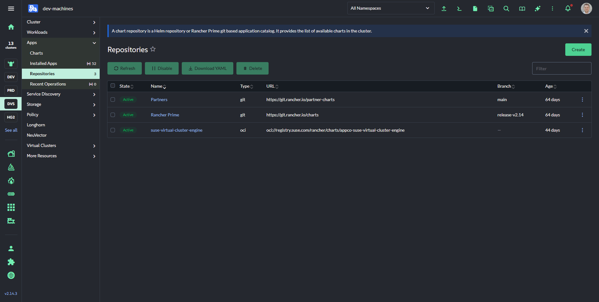
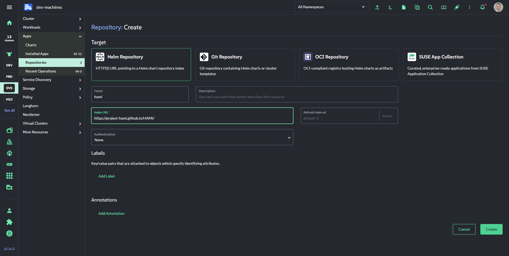
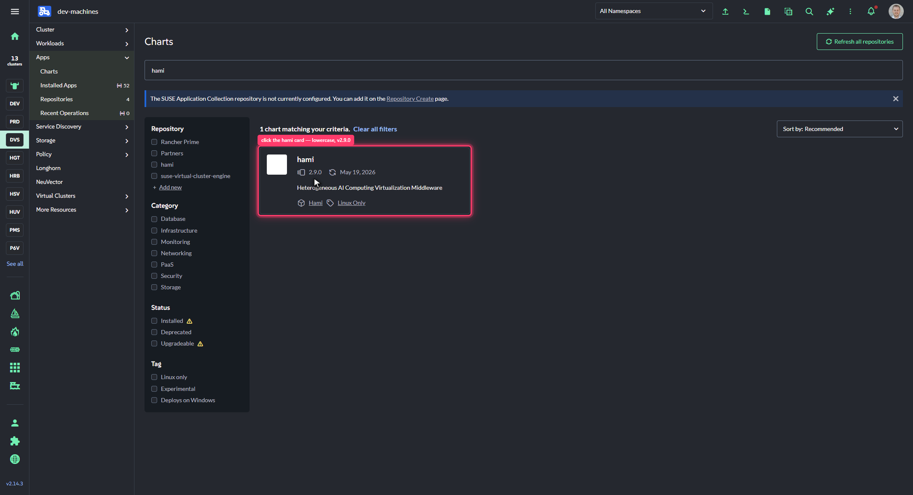
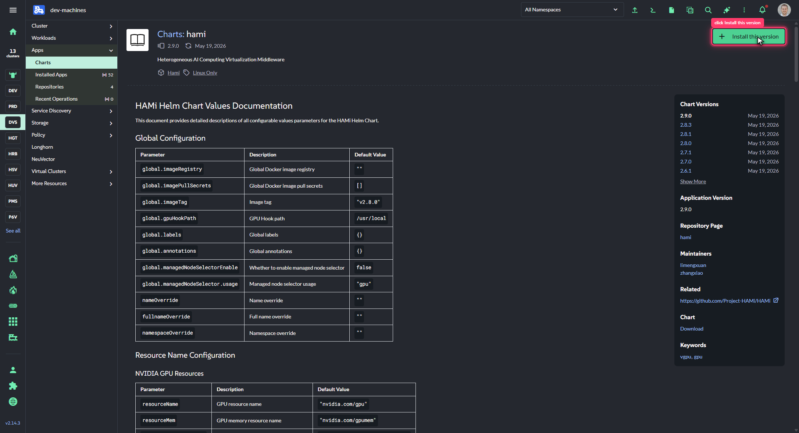
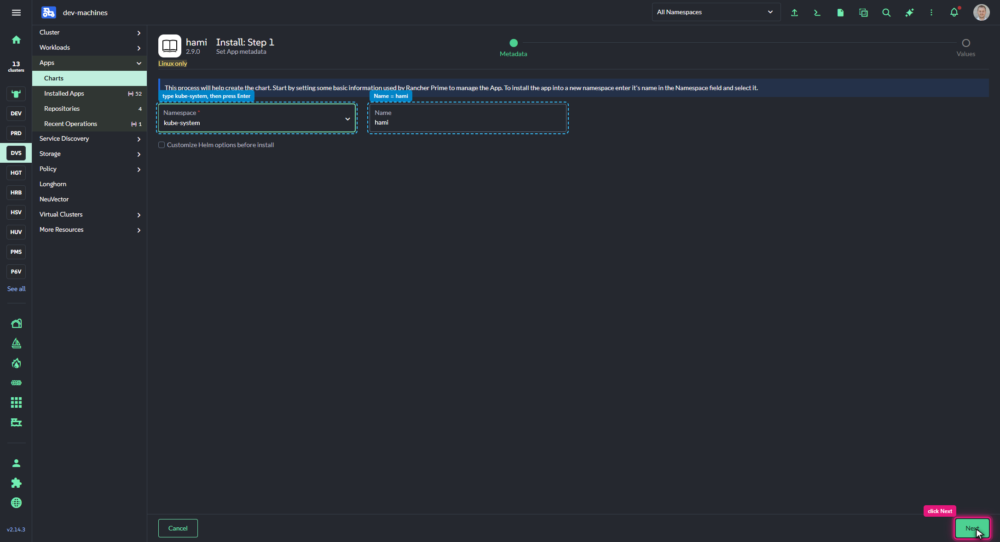
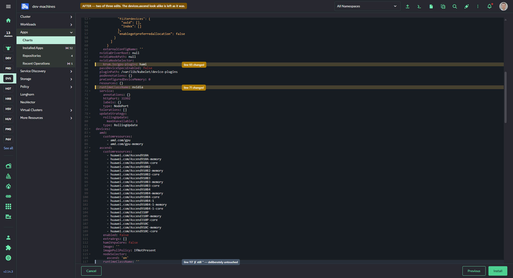
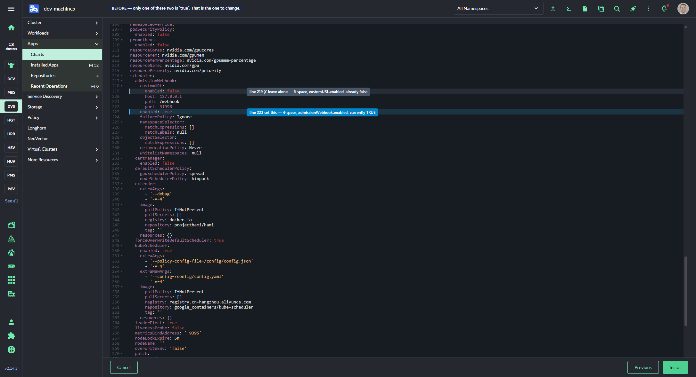

# HAMi on Rancher: the click-through path

*Part 6 of [a field report](../blog.md), and the first of a Rancher-specific pair. [Part 7](07-hami-on-rancher-fleet.md) does the same thing with Fleet.*

If you manage clusters through Rancher, the Apps and Charts UI is the obvious way to install HAMi, and it works. This is the whole path, including the parts where Rancher tells you something is fine when it is not.

One thing to read first: [part 3](03-rancher-values-editor.md), on why Rancher's values editor is not `helm -f values.yaml`. That is a real hazard, it has nothing to do with HAMi specifically, and this post routes around it rather than re-explaining it.

## Adding the repository

*Apps* → *Repositories* → *Create*, pick the **Helm Repository** target card, and fill in two fields.



| Field | Value |
| --- | --- |
| Name | `hami` |
| Index URL | `https://project-hami.github.io/HAMi/` |



Worth knowing: a `ClusterRepo` is exactly what the UI creates, so you can skip the clicking and still have everyone see the repo in their UI.

```yaml
apiVersion: catalog.cattle.io/v1
kind: ClusterRepo
metadata:
  name: hami
spec:
  url: https://project-hami.github.io/HAMi/
```

Either way, confirm it indexed before moving on. The chart will not appear until it has.

```sh
kubectl get clusterrepo hami -o jsonpath='{.status.conditions}' | grep -o 'Downloaded'
```

## Finding the chart

*Apps* → *Charts*, and **search the catalogue** rather than filtering by repository. The chart is listed lowercase as `hami`, described as "Heterogeneous AI Computing Virtualization Middleware".



Two URL quirks, since deep-linking is tempting: `?q=hami` works as a search. `?repo=hami` renders zero charts even with every repository checkbox ticked, which is a confusing five minutes if you assume the repo failed to index.



## Step 1: the two fields that do not default usefully



**Namespace** defaults to `default`. Type `kube-system` and press Enter to commit the combobox. Typing alone leaves it unselected, and the app installs into the wrong namespace — the text stays grey rather than turning solid, which is the only feedback you get.

**Name** has no default at all. Set `hami`.

## Step 2: three edits, in place

The wizard opens already in Edit YAML — there is no form-to-YAML toggle, only *Edit YAML* and *Compare Changes* — pre-filled with all 303 lines of the chart defaults.

Edit in place. Do not select-all and paste. ([Part 3](03-rancher-values-editor.md) is the why.)

You need three changes, and two of the three keys appear twice in the file:


Line 65, `gpu: 'on'` under `devicePlugin.nvidiaNodeSelector`, becomes a label you control. Line 71, `runtimeClassName: ''` at two-space indent under `devicePlugin`, becomes `nvidia`. The greyed line 117 is the same key under `devices.ascend` — leave it exactly as it is.



Then the webhook. Before you touch it, only one of the two nearby `enabled:` keys is `true`:




Note what the "after" image does *not* tell you: both lines now read `false`, so there is nothing on screen distinguishing the one you changed from the one you left. Go by indentation — four spaces for `admissionWebhook.enabled`, six for `customURL.enabled`.

On whether to disable it at all: leaving the webhook on turns on cluster-wide `schedulerName` rewriting the moment the app reports *Deployed*. If any GPU node is still served by `nvidia-device-plugin`, its pods get redirected to a scheduler that cannot place them. Off during a phased rollout, on at the end. [Part 2](02-the-install-that-broke-everything.md) is what that looks like when you get it wrong.


Three lines changed out of 303. The line count staying at 303 is the check worth doing before you press Install.

## What Rancher tells you, and what it does not

This is the part specific to the UI, and it is the reason this post exists separately from the Helm one.

**Deployed does not mean working.** Rancher marks the app *Deployed* as soon as Helm returns. Helm returns when the resources are created. A device plugin that starts and immediately crash-loops does not make the app red, does not raise an alert, and does not change the tile. We had a week of broken GPU scheduling sitting behind a green *Deployed*.

So verify from *Kubectl Shell* rather than from the app tile:

```sh
kubectl -n kube-system get pods -o wide | grep hami-device-plugin    # Running, not restarting
kubectl get node <node> -o jsonpath='{.metadata.annotations.hami\.io/node-nvidia-register}{"\n"}'
kubectl get node <node> -o jsonpath='{.status.allocatable.nvidia\.com/gpu}{"\n"}'
```

Then prove enforcement with an actual pod, because capacity numbers alone do not tell you the limit is real:

```text
name, memory.total [MiB]
NVIDIA GeForce RTX 2060 with Max-Q Design, 1024 MiB
```

That container was granted `nvidia.com/gpumem: 1024` on a physical 6144 MiB card.

**Nothing happens until you label a node.** The device plugin DaemonSet sits at `0 desired` until a node matches your selector, which is the correct and intended state right after install:

```sh
kubectl label node <node> gpu-plugin=hami --overwrite
```

**`kubectl delete app` is not the uninstall.** This one cost us a confusing ten minutes during teardown. Deleting the `App` object removes Rancher's record while leaving the Helm release running — `helm list -n kube-system` still shows it, and the workloads keep going.

```sh
helm uninstall hami -n kube-system     # if you end up in that state
```

Use *Apps* → *Installed Apps* → **hami** → *Delete*. And either way the node registration annotations survive, so clean them by hand:

```sh
kubectl annotate node <node> hami.io/node-nvidia-register- hami.io/node-handshake-
```

## When not to use this path

If GPUs are already in use on the cluster, the UI carries the same hazard as the CLI with less visibility — the webhook starts redirecting every GPU pod the moment the app reports *Deployed*. Use the [migration procedure](04-migrating-both-directions.md), which sequences that deliberately.

And for more than one cluster, this is a lot of clicking. That is [part 7](07-hami-on-rancher-fleet.md).

## What was tested

Walked end to end on Rancher v2.14.3 against RKE2 on SUSE Linux Micro, installing HAMi 2.9.0 onto one GPU node and rolling it back, twice — once on 2026-08-07 and again on 2026-08-14 to capture the annotated screenshots above. `helm get values` afterwards confirmed the edits landed exactly as intended, including the two look-alike keys left untouched.

Not tested: the UI path for node labels (we used `kubectl`), and the UI *Delete* for uninstall — we deleted the `App` object, which is how we found that it leaves the release running.

---

Next: [HAMi on Rancher with Fleet](07-hami-on-rancher-fleet.md) — the same install, delivered by GitOps, and the one thing Fleet cannot express.
