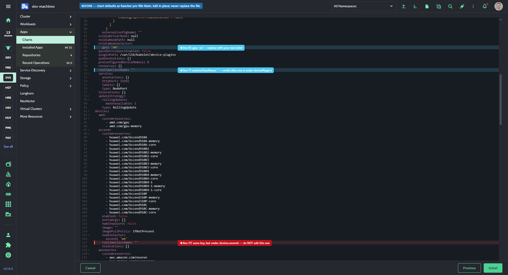
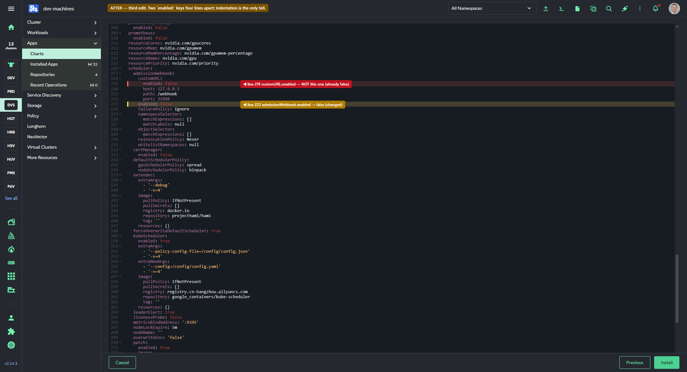
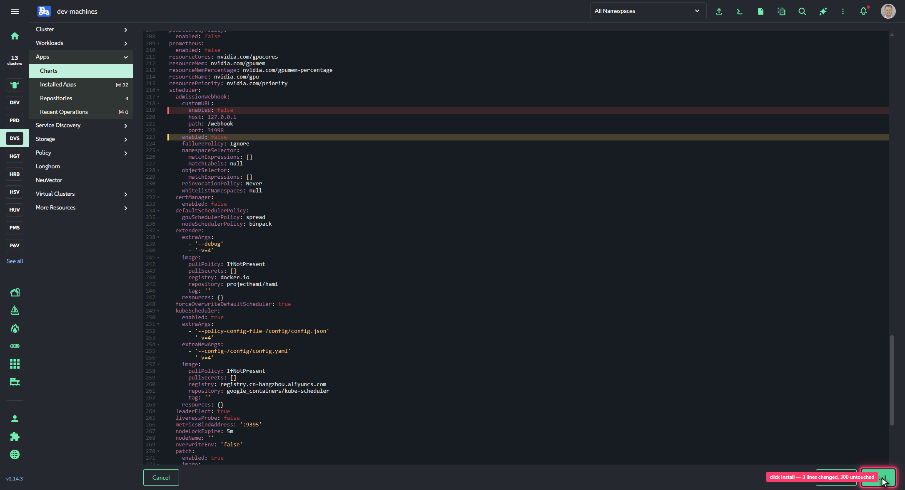

# Deploy HAMi from Rancher Apps

The same install as [`../deploy-with-helm/`](../deploy-with-helm), driven through Rancher instead of the CLI. Read that scenario first for what the values mean and why two of them are load-bearing.

**The one rule that matters here:** Rancher's values editor is **not** a Helm `-f values.yaml`. Edit the pre-populated YAML *in place*; never replace it. Section 2 explains why, and why getting this wrong produces an install failure whose error message points at the chart rather than at you.

Walked end to end on Rancher **v2.14.3** against an RKE2 cluster; screenshots in [`images/`](images) are from that run.

## 1. Add the chart repository

*Apps* → *Repositories* → *Create*.

In the screenshots throughout this page, a **red ring and cursor** mark the thing to click next, **blue** marks a field or line to set, and **amber** marks a line that has just been changed.


Pick the **Helm Repository** target card ("HTTP(S) URL pointing to a Helm chart repository index" — it is selected by default), then fill in:

| Field | Value |
| --- | --- |
| Name | `hami` |
| Index URL | `https://project-hami.github.io/HAMi/` |


Or declaratively, which is preferable across more than one cluster — a `ClusterRepo` is what the UI creates anyway:

```sh
kubectl apply -f clusterrepo.yaml
```

Confirm it indexed before moving on; the chart won't appear until it has:

```sh
kubectl get clusterrepo hami -o jsonpath='{.status.conditions}' | grep -o 'Downloaded'
```

## 2. Install the chart

*Apps* → *Charts*. **Search the catalogue for `hami`** rather than filtering by repository — the chart is listed lowercase `hami`, described as "Heterogeneous AI Computing Virtualization Middleware".


`?q=hami` works as a URL if you want to skip typing. `?repo=hami` does **not** — it renders zero charts even with every repository checked.

Open the chart and press **Install this version** (defaults to the newest, 2.9.0).


### Step 1 — metadata

Two fields, neither of which defaults usefully:

- **Namespace** — defaults to `default`. Type `kube-system` and **press Enter to commit the combobox**; typing alone leaves it unselected and the app lands in the wrong namespace.
- **Name** — set `hami`.


The namespace is committed when the text turns solid rather than grey — if it stays grey, the app installs into `default`.

### Step 2 — values

The wizard opens **already in Edit YAML** — there is no form-to-YAML toggle to switch, only *Edit YAML* / *Compare Changes* tabs — and the editor is **pre-filled with every chart default**: 303 lines for chart 2.9.0.

**Edit the values you need in place. Do not select-all and paste your own values file.**

Rancher does not pass this content to Helm as an overlay. It diffs the editor against the chart defaults and writes an explicit **`null`** for every key you removed. Replace the ~200 pre-filled lines with a 14-line values file and Rancher generates 76 explicit nulls, wiping out chart defaults you never intended to touch. The install then fails like this:

```text
Error: INSTALLATION FAILED: template: hami/templates/scheduler/deployment.yaml:151:59:
  executing "hami/templates/scheduler/deployment.yaml"
  at <.Values.scheduler.metricsBindAddress>: wrong type for value; expected string; got interface {}
```

Nothing in that message suggests the UI caused it — `scheduler.metricsBindAddress` was simply nulled out from under the template. The identical minimal values file installs cleanly via `helm install` from the CLI, because the CLI merges where Rancher nulls.

So make three targeted edits. **Two of the three keys appear more than once in the file** — indentation and parent are the only way to tell them apart, so check the parent before you type:

| Line | Find | Change to | Why |
| --- | --- | --- | --- |
| ~65 | `gpu: 'on'` under `devicePlugin.nvidiaNodeSelector:` | your own label, e.g. `gpu-plugin: hami` | so the plugin only lands on nodes you chose |
| ~71 | `runtimeClassName: ''` at **2-space** indent, under `devicePlugin:` | `nvidia` | without it the plugin can't reach NVML and crash-loops |
| ~223 | `enabled: true` at **4-space** indent, under `admissionWebhook:` | `false` **during a phased rollout** | see below |

The decoys, both of which look right and do nothing useful:

- **`runtimeClassName: ''` around line 117**, at 4-space indent under `devices.ascend:`. Edit that one and the install still succeeds while the device plugin keeps crash-looping — the exact failure the setting exists to prevent.
- **`enabled: false` around line 219**, at 6-space indent under `admissionWebhook.customURL:`, four lines above the one you want. It is already `false`, so "fixing" it changes nothing and leaves the real webhook on.

Before, with both targets in blue and the ascend decoy in red:



After the first two edits — note line 117 deliberately untouched:


And the webhook edit, with the `customURL` decoy marked. `metricsBindAddress: ':9395'` is visible further down, still intact — that is the value whose accidental removal breaks the install:



The complete change is in [`values.diff`](values.diff) — captured from the editor buffer itself, before and after:

```diff
   nvidiaNodeSelector:
-    gpu: 'on'
+    krum.io/gpu-plugin: hami
...
-  runtimeClassName: ''
+  runtimeClassName: nvidia
...
     customURL:
       enabled: false
       host: 127.0.0.1
       path: /webhook
       port: 31998
-    enabled: true
+    enabled: false
```

**303 lines before, 303 lines after.** That line count is the check worth doing: if yours drops, you removed keys, and Rancher will send them as explicit nulls.



Note the `gpu: null` trick from [the Helm scenario](../deploy-with-helm/) is **not** used here. There you add a null to remove the chart's default key; here you replace the line outright, because nulling removed keys is already what Rancher does.

**On the webhook:** leaving it enabled turns on cluster-wide `schedulerName` rewriting the moment the app reports *Deployed*. If any GPU node is still served by `nvidia-device-plugin`, its pods get redirected to `hami-scheduler` and stop scheduling. Set `enabled: false` until every GPU node has migrated — see [`../migrate-nvidia-to-hami/`](../migrate-nvidia-to-hami).

## 3. Label the GPU nodes

Nothing schedules until a node matches the selector. In the UI: *Nodes* → select node → *Edit Config* → *Labels*. Or:

```sh
kubectl label node <node> gpu-plugin=hami --overwrite
```

## 4. Verify

Rancher shows the app *Deployed* as soon as Helm returns, which happens well before the device plugin is working — a crash-looping DaemonSet does not make the app red. Check the real signals from *Kubectl Shell*:

```sh
kubectl -n kube-system get pods -o wide | grep hami-device-plugin   # Running, not restarting
kubectl get node <node> -o jsonpath='{.metadata.annotations.hami\.io/node-nvidia-register}{"\n"}'
kubectl get node <node> -o jsonpath='{.status.allocatable.nvidia\.com/gpu}{"\n"}'
```

Then prove enforcement with [`../../samples/vgpu-smoke-test.yaml`](../../samples) — the container should report its limit, not the card's real memory.

## Uninstalling

*Apps* → *Installed Apps* → **hami** → *Delete*.

**Deleting the `App` object with `kubectl` is not equivalent.** Doing so removes Rancher's record but leaves the Helm release running — `helm list -n kube-system` still shows it, and the workloads keep going. If you end up in that state:

```sh
helm uninstall hami -n kube-system
```

Either way, the node registration annotations survive and need removing by hand:

```sh
kubectl annotate node <node> hami.io/node-nvidia-register- hami.io/node-handshake-
```

## When not to use this path

If GPUs are already in use on the cluster, the UI has the same hazard as the CLI with less visibility — the webhook starts redirecting every GPU pod the moment the app reports *Deployed*. Use [`../migrate-nvidia-to-hami/`](../migrate-nvidia-to-hami), which sequences it deliberately.

For fleets, [`../deploy-with-fleet/`](../deploy-with-fleet) is the better fit — a `ClusterRepo` plus a per-cluster app install is a lot of clicking compared to one bundle targeting a label.

## Validated

Walked end to end twice on Rancher v2.14.3 / RKE2 / SL Micro — 2026-08-07 and again 2026-08-14 to capture the annotated screenshots — installing HAMi 2.9.0 onto one GPU node and rolling it back each time. Confirmed:

- The wholesale-paste failure above is real and reproducible — it is how this scenario was first written, and it failed on the first attempt. The generated values file carried 76 explicit nulls.
- Editing in place installed cleanly both times: scheduler `1/1`, device-plugin DaemonSet at `0` desired until a node was labelled.
- The decoy keys are not theoretical. After install, `helm get values` reported `devicePlugin.runtimeClassName: 'nvidia'` **and** `devices.ascend.runtimeClassName: ''` — the correct one changed, the look-alike untouched — with `scheduler.metricsBindAddress: ':9395'` preserved and `admissionWebhook.enabled: False`.
- Labelling one node swapped plugins in **seconds** — the sibling `nvidia-device-plugin` stepped aside on its own via a `NotIn` affinity on the same label.
- **Fleet did not need pausing.** With no HAMi bundle in git and the plugin label absent from the machine-pool spec, GitOps never contended with the hand-driven install.
- A pod limited to `nvidia.com/gpumem: 1024` reported `1024 MiB` from `nvidia-smi` against a physical 6144 MiB card, with `HAMI-core` interception messages in its log.
- Teardown restored `nvidia.com/gpu: 1` per node with no leftovers, once the orphaned release and the node annotations were cleaned up by hand.

Not covered: the UI label path in step 3 (labels were applied with `kubectl`), and the UI *Delete* path in the uninstall section.
